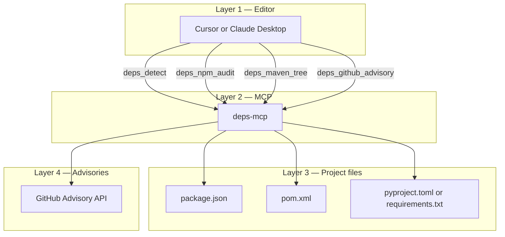
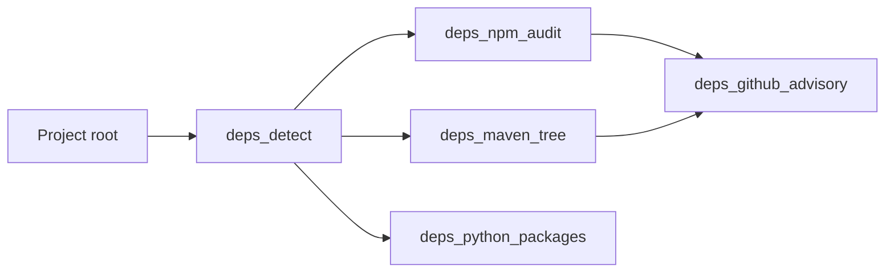

# Deps MCP Server

Open-source MCP server owned by **Pawan Gunjkar** (`pawangunjkar@gmail.com` · [GitHub](https://github.com/Pawangunjkar)). MIT licensed.

Developers ask which package is vulnerable without opening npm, Maven, or the GitHub advisory site. The server detects the project type, runs the ecosystem audit, and can look up a GitHub Security Advisory for one package.

Sibling servers: [github-mcp](https://github.com/Pawangunjkar/github-mcp), [db-mcp](https://github.com/Pawangunjkar/db-mcp), [agent-trace-mcp](https://github.com/Pawangunjkar/agent-trace-mcp).

## Project information

| Item | Value |
| --- | --- |
| Package | `deps-mcp` |
| Runtime | Python 3.10+, FastMCP, stdio |
| Ecosystems | npm (`npm audit`), Maven (`dependency:tree`), Python manifests |
| Advisories | GitHub Advisory API (`npm`, `maven`, `pip`, `nuget`) |
| Writes | None. This server does not upgrade or install packages |

## Architecture





## Tools

| Tool | What it does |
| --- | --- |
| `deps_detect` | Finds npm, Maven, and Python manifests |
| `deps_npm_audit` | Runs `npm audit --json` and returns the first 40 vulnerable packages |
| `deps_maven_tree` | Runs `mvn dependency:tree` |
| `deps_python_packages` | Lists `requirements.txt` or shows `pyproject.toml` |
| `deps_github_advisory` | Looks up GHSA/CVE rows for one package |

Set `GITHUB_TOKEN` for higher advisory rate limits. Set `DEPS_ROOT` when the chat does not pass a path.

## Cursor

```json
{
  "mcpServers": {
    "deps": {
      "command": "uv",
      "args": ["run", "--directory", "C:/AI_Workspaces/Anti_Workspace/deps-mcp", "server.py"],
      "env": {
        "DEPS_ROOT": "C:/AI_Workspaces/Anti_Workspace/enterprise-commerce-agents",
        "GITHUB_TOKEN": ""
      }
    }
  }
}
```
